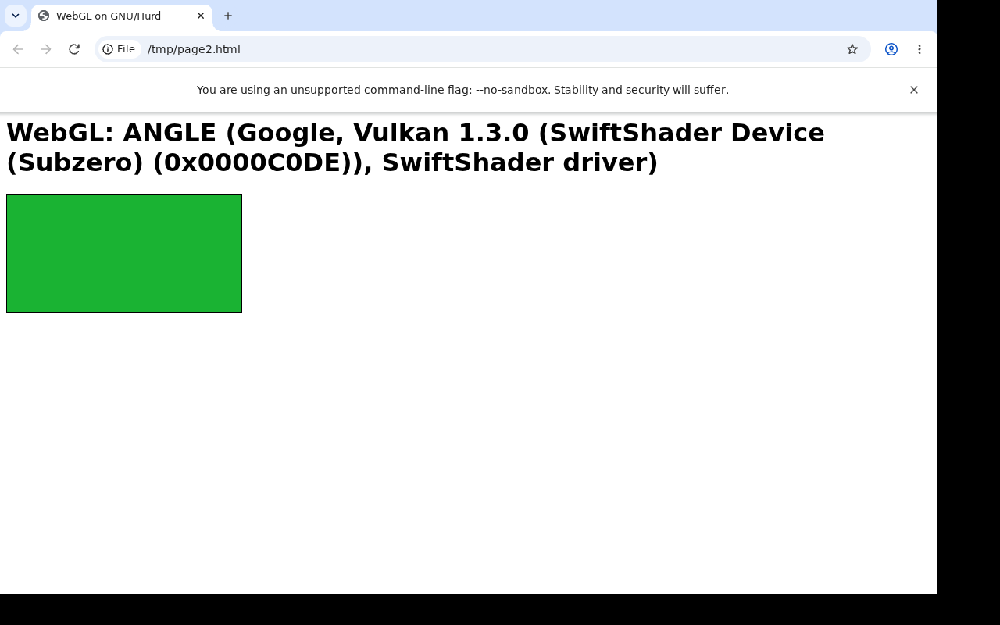

# Developing the port

## Working tree

Patches are developed in an extracted release tarball that is turned into a
git repository, so `git diff` shows exactly what the port changes:

```sh
SRC=$(scripts/fetch-source.sh "$WORK")
cd "$SRC" && git init -q && git add -A && git commit -qm "Chromium $(cat CHROMIUM_VERSION)"
cd - && scripts/apply-patches.sh "$SRC"
```

Edit files in `$SRC`, then regenerate the patch set:

```sh
scripts/export-patches.py "$SRC"     # rewrites patches/*.patch and patches/series
```

New files go into `overlay/` (same relative path as in the Chromium tree);
`apply-patches.sh` copies them in before applying the patches.

## Build loop

```sh
docker run --rm --platform linux/amd64 \
  -v "$PWD":/port -v "$WORK":/work chromium-hurd-build \
  /port/scripts/build.sh "/work/chromium-$(cat CHROMIUM_VERSION)" \
                         /work/sysroot-hurd-amd64 base
```

Useful intermediate targets, in order of size: `base`, `check_example`
(smallest executable linking `//base`), `base_unittests`, `content_shell`,
`chrome`. Run ninja with `-k 0` to collect all errors of a round at once.

## Testing on the Hurd

Boot the Debian GNU/Hurd amd64 image in QEMU (see `scripts/run-vm.sh`) and
copy a test bundle over SSH (port 2222 on the host):

```sh
scripts/make-test-bundle.sh "$SRC" "$WORK/sysroot-hurd-amd64" bundle.tar.gz
# on the Hurd:
mkdir -p /opt/chromium && tar xzf bundle.tar.gz -C /opt/chromium
/opt/chromium/run-chrome --version
```

The bundle carries the sysroot's glibc, dynamic linker and libraries, so it
runs on systems with older installed libraries (the sysroot is built from
unstable). `run-chrome` adds `--no-sandbox --no-zygote` and raises the IPC
connection timeout for emulated machines.

Headless rendering:

```sh
/opt/chromium/run-chrome --headless --dump-dom --user-data-dir=/tmp/p \
  'data:text/html,<h1>Hello</h1>'
```

### X11

Xorg on the Hurd needs the console's keyboard and does not start from an SSH
session. Use Xvfb instead. The debian-ports `xvfb` package may need a newer
glibc than the image provides; unpack it and run it with the bundle's glibc:

```sh
dpkg -x xvfb_*_hurd-amd64.deb /opt/xvfb
/opt/chromium/lib/ld-x86-64.so.1 \
  --library-path /opt/chromium/lib:/lib/x86_64-gnu:/usr/lib/x86_64-gnu \
  /opt/xvfb/usr/bin/Xvfb :1 -screen 0 1280x800x24 -nolisten tcp &
DISPLAY=:1 /opt/chromium/run-chrome --ozone-platform=x11 \
  --user-data-dir=/tmp/p file:///tmp/page.html &
DISPLAY=:1 xwd -root -silent > shot.xwd   # screenshot
```

Xvfb has no OpenGL, so the GPU process falls back to software compositing
(the "Exiting GPU process due to errors during initialization" messages are
expected). `--use-angle=swiftshader --enable-unsafe-swiftshader` uses SwANGLE
instead, which is also needed for WebGL.

The QEMU user-mode network works once the host firewall allows `qemu`;
pages such as https://duckduckgo.com load and render:


WebGL with `--use-angle=swiftshader --enable-unsafe-swiftshader`:



## Debian package

`scripts/make-deb.py` packs the build as `chromium_<version>-0hurd1_hurd-amd64.deb`
(installed into `/usr/lib/chromium`, started via `/usr/bin/chromium`). Its
Depends are derived from the DT_NEEDED entries of the shipped ELF files and
the sysroot packages providing them, so the package targets a system that
matches the sysroot (unstable). Run it in the build container:

```sh
scripts/make-deb.py "$SRC" "$WORK/sysroot-hurd-amd64" "$WORK/deb"
```

On Apple Silicon, use an AHCI disk (`-device ahci`); the Hurd's rumpdisk
reports I/O errors on QEMU's emulated PIIX IDE controller under TCG.
